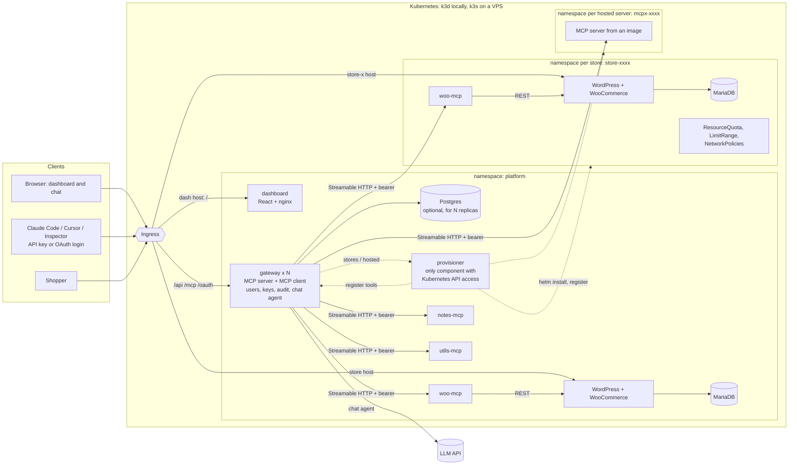

# WooCommerce hosting platform with a team MCP gateway

A WooCommerce store on Kubernetes, an MCP server for it written from scratch, and a **gateway** that lets an admin
register MCP servers once so every team member can use all of them through **one MCP endpoint** and through a **chat
agent** in a React dashboard. Stores can also be provisioned from the dashboard, each in its own namespace.

One Helm chart runs on a local k3d cluster and on a k3s VPS; only the values file differs.



Both the chat agent and external clients reach every upstream **only** through the gateway. The upstream servers are
ClusterIP services protected by NetworkPolicies; nothing else can talk to them.

## What is in the box

| Layer                | Where                  | Notes                                                                                                                                                                                                                                           |
| -------------------- | ---------------------- | ----------------------------------------------------------------------------------------------------------------------------------------------------------------------------------------------------------------------------------------------- |
| Store                | `services/wordpress`   | Official WordPress image with WooCommerce and Storefront baked in (pinned versions). Idempotent bootstrap: install, Cash on Delivery, shipping, sample product, REST key from a Secret.                                                         |
| WooCommerce MCP      | `services/woo-mcp`     | Written from scratch. Streamable HTTP. Tools: `list_products`, `get_product`, `create_product`, `list_orders`, `get_order`, `update_order_status`. Talks to WooCommerce over its REST API ([why](docs/ARCHITECTURE.md#woocommerce-mcp-server)). |
| Extra upstreams      | `services/demo-mcp`    | `notes` (shared scratch-pad) and `utils` (calculator, clock). Both expose `ping` to demonstrate name-collision handling.                                                                                                                        |
| Gateway              | `services/gateway`     | Node 22. REST API, MCP endpoints, OAuth server, chat agent, audit log. SQLite by default, Postgres for several replicas.                                                                                                                        |
| Dashboard            | `services/dashboard`   | React + Vite on unprivileged nginx: servers, stores, chat, API keys, audit log, metrics, team.                                                                                                                                                  |
| Provisioner          | `services/provisioner` | Creates and deletes stores and hosted MCP servers with Helm, one namespace each, and registers them in the gateway. State lives in namespace annotations, so it recovers from restarts.                                                         |
| Helm charts          | `charts/`              | `platform` (everything, plus `mode: store` for a tenant store) and `hosted-mcp`. Values: `values-local.yaml`, `values-prod.yaml`.                                                                                                               |
| Tests and demo flows | `tests/`               | End-to-end test with real processes, live-cluster demos, a UI smoke test.                                                                                                                                                                       |

## Quick start (local)

Requirements: Docker Desktop (4 GB+ RAM for the cluster), [k3d](https://k3d.io), kubectl, Helm 3, Node 22, and a bash shell
(Git Bash on Windows). `make` is optional: every target is a thin wrapper over a script in `scripts/`.

```bash
export LLM_API_KEY=...            # optional; only the chat agent needs it (see "Chat model" below)
make up                           # cluster + images + helm install + prints the generated logins
```

Without `make`: `scripts/k3d-up.sh && scripts/build-images.sh && scripts/deploy-local.sh && scripts/creds.sh`.

| What                     | URL                                                                                 |
| ------------------------ | ----------------------------------------------------------------------------------- |
| Storefront               | http://store.localtest.me:8080 (WooCommerce admin at `/wp-admin`, user `shopadmin`) |
| Dashboard                | http://dash.localtest.me:8080 (`admin@example.com`)                                 |
| MCP endpoint             | http://dash.localtest.me:8080/mcp                                                   |
| MCP endpoint, many tools | http://dash.localtest.me:8080/mcp/search                                            |
| Provisioned stores       | `http://store-<name>.stores.localtest.me:8080`                                      |

**Local domain approach:** `*.localtest.me` (and every subdomain of it) is public wildcard DNS for `127.0.0.1`, and k3d maps host
port 8080 to the cluster's Traefik ingress. Stable URLs work with no `/etc/hosts` edits. On kind, set `ingress.className=nginx` and
`networkPolicy.ingressControllerNamespace=ingress-nginx`.

`make creds` prints the passwords; they live in a Kubernetes Secret, never in this repository.

### Chat model

The provider is your choice (`llm.provider`: `anthropic`, `openai` for any OpenAI-compatible API such as Groq, OpenRouter, Gemini or
Ollama, or `mock`). The key is passed with `--set secrets.llmApiKey=...` (or `LLM_API_KEY=... make deploy`) and stored in the cluster
Secret. `LLM_PROVIDER=mock make deploy` runs a scripted model that exercises the real tool loop without any key.

## Demos (the definition of done)

With the cluster up (`make demo`, `make demo-stores`, `make demo-hosted`, `make demo-replicas` or `node tests/<file>`):

| Script                    | What it proves                                                                                                                                                                                                                                                                                                  |
| ------------------------- | --------------------------------------------------------------------------------------------------------------------------------------------------------------------------------------------------------------------------------------------------------------------------------------------------------------- |
| `tests/cluster-demo.mjs`  | Storefront checkout with COD; admin sees woo/notes/utils; user A's chat creates a product (appears on the storefront) and returns a hand-placed order; user B's external MCP client sees every tool, gets the same order and runs a woo + utils + notes workflow; revoke, disable, pod kill; audit attribution. |
| `STORES=1` (same script)  | Two stores provisioned in parallel, retry-safe create, per-user limit, cross-store orders comparison, NetworkPolicy isolation probe, delete one store and watch its namespace, volumes and tools disappear.                                                                                                     |
| `tests/hosted-demo.mjs`   | Deploys an MCP server from an image (registry allow-list), registers it, removes it cleanly.                                                                                                                                                                                                                    |
| `tests/replicas-demo.mjs` | Two gateway replicas on Postgres: sessions, keys, revocation and rate limits are shared; MCP traffic is spread over both; a pod can die without errors.                                                                                                                                                         |

A manual walkthrough with the same steps is in [docs/DEMO.md](docs/DEMO.md).

## Requirements checklist

| Requirement                                           | How it is met                                                                                                             |
| ----------------------------------------------------- | ------------------------------------------------------------------------------------------------------------------------- |
| Local Kubernetes and the same chart on a VPS          | k3d locally, k3s on a VPS; `values-local.yaml` vs `values-prod.yaml` ([deploy guide](docs/DEPLOY-VPS.md)).                |
| Helm only                                             | `charts/platform`, `charts/hosted-mcp`; no Kustomize.                                                                     |
| Everything in-cluster, persistent store               | MariaDB StatefulSet PVC, WordPress content PVC, gateway PVC (or Postgres PVC).                                            |
| Ingress with stable URLs                              | Two Ingress objects (store; dashboard + gateway) plus one per provisioned store.                                          |
| Probes and requests/limits on every workload          | All workloads, including the provisioner and Postgres. `helm lint` plus the live cluster verify it.                       |
| No hardcoded secrets                                  | One Kubernetes Secret (generated or `existingSecret`), consumed with `secretKeyRef`.                                      |
| Own WooCommerce MCP server, Streamable HTTP, ≥5 tools | `services/woo-mcp`; ClusterIP, no Ingress, NetworkPolicy admits only the gateway, bearer token.                           |
| Gateway: add/edit/disable/remove, credentials         | Dashboard **Servers** page. Credentials are AES-256-GCM encrypted at rest and never returned.                             |
| One endpoint, routing, collisions, isolation          | `POST /mcp`; tools are `<server>__<tool>`; cached listing; per-call deadline; one failing upstream never affects another. |
| ≥3 upstreams                                          | woo, notes, utils (plus any store or hosted server).                                                                      |
| Roles, hashed revocable keys, audit log               | admin and member; SHA-256-hashed `gw_` keys; **Audit log** page with user, server, tool, time, duration, outcome.         |
| Chat agent as the logged-in user, shows tool calls    | `POST /api/chat`, audit `source=chat`, tool trace in the UI.                                                              |

### Bonus and differentiators

| Item                           | Status                                                                                                                                                                                                                                               |
| ------------------------------ | ---------------------------------------------------------------------------------------------------------------------------------------------------------------------------------------------------------------------------------------------------- |
| Multi-store provisioning       | Done and demonstrated: own namespace, DB, Secrets, PVCs and Ingress per store; automatic MCP registration; clean teardown; NetworkPolicy isolation; ResourceQuota and LimitRange; per-user limit; provisioning timeout; idempotent and restart-safe. |
| Tool permissions               | Done: admin-only tool patterns per server, hidden from lists and rejected if called (also through search/execute).                                                                                                                                   |
| OAuth on the gateway           | Done: protected-resource and authorization-server metadata, dynamic client registration, authorization code with PKCE, refresh rotation, revocable connections. Verified by the e2e test with a scripted PKCE client; not tried with a real client.  |
| Handling many tools            | Done: `/mcp/search` exposes `search_tools`, `describe_tool`, `call_tool`; the chat agent switches to it above 40 tools.                                                                                                                              |
| Hosted MCP servers             | Done and demonstrated: image on a registry allow-list, own namespace, generated token Secret, quota, deny-by-default NetworkPolicy, clean removal.                                                                                                   |
| Security hardening             | SSRF guard, encrypted credentials, non-root read-only containers, default-deny NetworkPolicies, least-privilege ClusterRole for the provisioner (no RBAC verbs, no exec, no nodes), hosted-image registry allow-list.                                |
| Scaling                        | Done and demonstrated: 2 gateway replicas on Postgres, stateless MCP, shared rate limit, PodDisruptionBudget, preStop drain.                                                                                                                         |
| Observability                  | `/metrics` (calls, outcomes, latency, upstream up/tools), per-server stats page, upstream failure reasons in the UI.                                                                                                                                 |
| Upgrades and rollback          | Demonstrated with `helm upgrade` then `helm rollback` ([guide](docs/DEPLOY-VPS.md#upgrades-and-rollback)).                                                                                                                                           |
| Production-like VPS deployment | Prepared, **not deployed**: I had no VPS. `values-prod.yaml` lints and renders; the guide covers DNS, k3s, cert-manager TLS, secrets and registry.                                                                                                   |

## Repository layout

```
charts/platform/     Helm chart: gateway, dashboard, demo servers, provisioner, Postgres, primary store; mode=store for tenant stores
charts/hosted-mcp/   Helm chart for one hosted MCP server
services/            gateway, provisioner, dashboard, woo-mcp, demo-mcp, wordpress (each with its Dockerfile and tests)
scripts/             k3d-up, build-images, deploy-local, creds, create-secret, push-images, dev
tests/               e2e.mjs, cluster/hosted/replicas demos, ui-smoke.mjs, mock WooCommerce
docs/                ARCHITECTURE, DEMO, DEPLOY-VPS
```

## Development

```bash
make install-deps    # npm install everywhere
make test            # unit tests of every service
make e2e             # end-to-end test with real processes and a fake store (E2E_POSTGRES=1 make e2e uses Postgres)
make lint            # ESLint, Prettier check, helm lint of every values file and mode
make dev             # whole platform on your machine without Kubernetes (fake store, mock chat model, Vite dashboard)
```

## What was verified, and what was not

Verified on a real local k3d cluster (Docker Desktop, Windows) with the real WordPress/WooCommerce images:

- The definition-of-done flow, scripted in `tests/cluster-demo.mjs`, including a hand-placed storefront order and an agent-created product that appears on the storefront.
- Multi-store provisioning with two stores at once, cross-store orders, isolation probes, deletion (namespace, PVCs and tools gone), a failed provisioning recovered with retry.
- Hosted MCP servers, two gateway replicas on Postgres, `helm upgrade` and `helm rollback`.
- Automated: 4 + 3 + 8 + 9 unit tests, 19 end-to-end checks on SQLite and on Postgres, UI smoke test, ESLint and Prettier clean, `helm lint` and `helm template` for local, prod, store and replica variants.

Not verified:

- **A real LLM.** No API key was available; the tool loop was exercised with the scripted `mock` model. The Anthropic and OpenAI adapters are untested against live APIs.
- **A VPS and cert-manager TLS.** Only rendered, never deployed.
- **A real MCP client** (Claude Code, Cursor, Inspector) and a real OAuth login. The official MCP SDK client is used in the tests, and the OAuth flow is driven by a script.
- **The dashboard in a real browser.** It is rendered in jsdom and clicked through; visual layout and CSS are unchecked.
- Load, or the behaviour with more than two replicas or many stores (the local Docker VM had 4 GB of RAM; each store needs roughly 0.4 GB).
