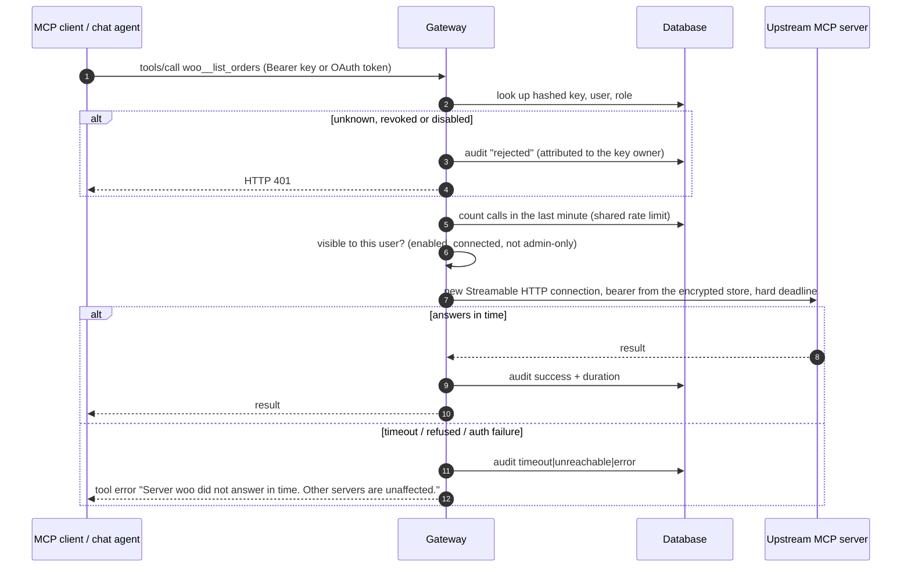
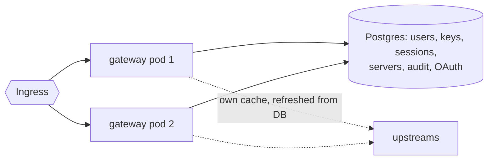
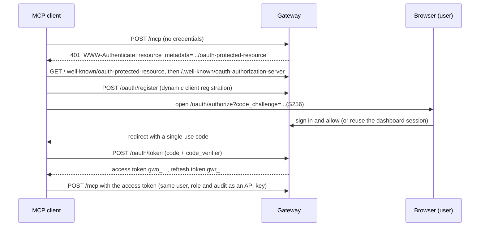
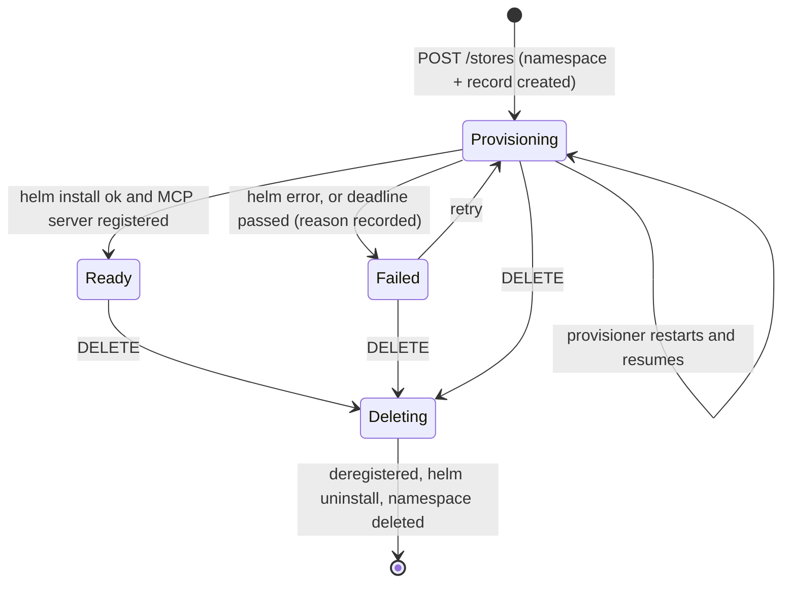

# Architecture and design decisions

See the [README](../README.md) for the system diagram. This document explains how the parts behave and why they were built this way.

## Request path: one tool call

Chat and external MCP clients take the same path through the gateway's router. That is why permissions, rate limits, timeouts and
the audit log behave identically for both.

## WooCommerce MCP server

`services/woo-mcp` calls the **WooCommerce REST API (`/wp-json/wc/v3`)** over the cluster network with a consumer key and secret
(HTTP Basic).

Why REST rather than WP-CLI or direct SQL:

| Option       | Verdict                                                                                                                                                                                                                                                                                                                                                                                            |
| ------------ | -------------------------------------------------------------------------------------------------------------------------------------------------------------------------------------------------------------------------------------------------------------------------------------------------------------------------------------------------------------------------------------------------- |
| **REST API** | Official, versioned, validated contract. Product and order changes run through WooCommerce's own business logic (stock, taxes, hooks, emails, caches). Works across a network boundary, so woo-mcp is a tiny separate pod with no access to the database or WordPress files. Fits least privilege: the key can be rotated or scoped, and a NetworkPolicy lets the pod talk to exactly one Service. |
| WP-CLI       | Needs the WordPress code and DB credentials inside the MCP pod, or `kubectl exec` rights (a powerful ServiceAccount). A process spawn per call is slow and the blast radius is much larger.                                                                                                                                                                                                        |
| Direct SQL   | Bypasses WooCommerce logic and corrupts caches and order meta. Rejected.                                                                                                                                                                                                                                                                                                                           |

Details worth knowing:

- WooCommerce only accepts Basic key auth on requests it considers HTTPS. In-cluster traffic is plain HTTP, so woo-mcp sends
  `X-Forwarded-Proto: https` and `wp-config.php` (via `WORDPRESS_CONFIG_EXTRA`) maps that header to `$_SERVER['HTTPS']`. Anyone who can
  reach WordPress can send that header, but they still need a valid consumer key, and NetworkPolicies limit who can reach WordPress.
- The REST key is created by the bootstrap script in the WordPress image from values in a Kubernetes Secret, so nothing sits in an
  image or in git.
- "Today" is resolved in the store's timezone (`store.timezone`) by the server, so a model only says `date: "today"`.
- The server is stateless Streamable HTTP: every request builds a fresh MCP server instance.
- WooCommerce is pinned (`WC_VERSION`) together with its WordPress base image. "Latest stable" broke the first real build, because
  WooCommerce 11 requires WordPress 7 while the `wordpress:6` image was still in use.

## Gateway

### Tool names and collisions

Every tool is exposed as `<server-slug>__<tool>`: `woo__list_orders`, `notes__ping`, `utils__ping`, `store-acme__list_orders`.

- Slugs are unique (database constraint) and limited to `[a-z0-9-]`, so they never contain `_`. Two servers exposing the same tool
  name cannot collide, and the prefix tells a model which server (or which **store**) a tool acts on.
- Always prefixing, instead of only on collision, keeps names stable: adding a server later never renames existing tools.
- Names are sanitised to `[A-Za-z0-9_-]` and capped at 64 characters; longer ones get a deterministic hash suffix.
- The slug is fixed when a server is created, because changing it would rename its tools.

### Failure isolation

- `tools/list` is answered from a cache that a background loop refreshes every 10 s, concurrently, each server with a 5 s timeout. A dead
  or slow upstream can never delay listing and only affects its own entry.
- Servers that fail their health check are marked **Unreachable** with the reason (connection refused, DNS not found, credential
  rejected, timeout) and their tools are hidden.
- `tools/call` opens a fresh connection with a hard deadline (30 s default) and returns an in-band tool error (`isError: true`). A failed
  call also flips the server to Unreachable immediately.
- Disabling a server removes its tools in the same request.

### Many tools: search and execute

Ten servers can mean hundreds of tools, too many to give a model at once. `POST /mcp/search` exposes three tools instead:

| Tool            | Purpose                                                                                 |
| --------------- | --------------------------------------------------------------------------------------- |
| `search_tools`  | Ranks the caller's visible tools against a free-text query (name, server, description). |
| `describe_tool` | Returns the full description and input schema of one tool, on demand.                   |
| `call_tool`     | Runs a tool by name through the normal router.                                          |

`call_tool` goes through the same code as `/mcp`, so permissions (admin-only tools), rate limits, timeouts and the audit log are not
bypassed. The chat agent switches to this mode automatically when the user can see more than `chatMaxDirectTools` (40) tools.

### Scaling to several replicas

- MCP is stateless (`sessionIdGenerator: undefined`, JSON responses): no session lives in a pod, so any replica answers any request.
- The database layer has two back ends behind one async interface: SQLite (default, one replica) and Postgres (`postgres.enabled=true`).
  Replicas share users, keys, sessions, servers and the audit log.
- Each replica caches the server rows and the tool lists it discovers, and reloads the rows from the database every poll and at most
  every 2 s per request, so disabling a server on one replica takes effect on the others within about 2 seconds.
- The per-user rate limit counts calls in the shared audit table, so the limit does not multiply with the replica count.
- The chart refuses `gateway.replicas > 1` without Postgres, adds a PodDisruptionBudget and topology spread, and gives pods a `preStop`
  drain delay. Without that delay, deleting a pod produced HTTP 502s in the replicas demo.

## Authentication

| Path                                 | Mechanism                                                                                                                                                      |
| ------------------------------------ | -------------------------------------------------------------------------------------------------------------------------------------------------------------- |
| Dashboard                            | scrypt password hashes; HttpOnly, SameSite=Lax session cookie (Secure over HTTPS); login throttling; cross-origin writes refused; single-use invitation links. |
| MCP, option 1: API key               | `gw_` + 256 random bits, shown once, stored only as SHA-256 hash. Revocation takes effect on the next request and is audited under the key owner.              |
| MCP, option 2: OAuth (MCP auth spec) | Browser login. See below.                                                                                                                                      |

Tokens and codes are random and stored only as hashes; PKCE (S256) is mandatory; refresh tokens rotate; redirect URIs must be
https, loopback http or a custom app scheme; a user can disconnect a client from the **API keys** page.

## Multi-store provisioning

- **Where state lives.** Each store is a namespace (`store-<id>`). Its labels and annotations hold the owner, name, slug, phase,
  reason and deadline. There is no separate database, so a restarted provisioner recovers by listing namespaces.
- **What is created.** The same `charts/platform` chart with `mode=store`: MariaDB with a PVC, WordPress with a PVC, woo-mcp, Secret
  (generated passwords and REST key), Ingress on `<slug>.<storeDomainSuffix>`, ResourceQuota, LimitRange and NetworkPolicies.
- **Registration.** When Helm finishes, the provisioner reads the store's MCP token from its Secret and calls the gateway's
  cluster-internal API (`PUT /internal/servers/<id>`). The gateway stores the credential encrypted. The tools appear as
  `store-<name>__*`. A reconcile loop re-registers missing entries and removes registrations of stores that no longer exist.
- **Safe to retry.** The store id is derived from the caller and an `Idempotency-Key`, namespace creation adopts an existing namespace,
  Helm install is `upgrade --install`, and registration is a `PUT`. The retry endpoint re-runs a Failed store with a fresh deadline.
- **Restart safety.** On start the provisioner resumes Provisioning stores that still have time left, fails overdue ones with
  "timed out after N s", and finishes any deletion that was interrupted.
- **Guardrails.** Per-user and total store limits, a provisioning timeout, and a per-namespace ResourceQuota and LimitRange.
- **Teardown.** Deregister, `helm uninstall`, delete the namespace. That removes the PVCs, Secrets and Ingress with it.

### Isolation between stores

Every store namespace has a default-deny NetworkPolicy for ingress and egress, then explicit allows:

| Pod       | May receive from                                 | May send to                                                                    |
| --------- | ------------------------------------------------ | ------------------------------------------------------------------------------ |
| woo-mcp   | only the gateway pod in the `platform` namespace | its own WordPress, DNS                                                         |
| WordPress | the ingress controller, its own woo-mcp          | its own MariaDB, DNS, and public addresses on 80/443 (private ranges excluded) |
| MariaDB   | its own WordPress                                | DNS                                                                            |

The demo probes this from inside store A's woo-mcp pod: its own WordPress answers, while store B's WordPress and MariaDB are refused.
This depends on a CNI that enforces NetworkPolicies (k3s and k3d do).

## Hosted MCP servers

An admin can deploy a server from a container image instead of registering a URL. The provisioner creates `mcpx-<id>` and installs
`charts/hosted-mcp`: Deployment (non-root, read-only filesystem, probes, limits), a Service, a generated token Secret (injected into
the env var you name), a ResourceQuota, and NetworkPolicies that only let the gateway in and allow egress to DNS and public HTTPS.
Images must come from a registry allow-list (`provisioner.hosted.allowedRegistries`). Deleting the hosted server removes the
namespace, the Secret and the gateway registration. Servers created this way are marked managed: they can be disabled but not edited or
removed through the normal server API.

## Security model

| Concern              | What the code does                                                                                                                                                                                                                                                                                             |
| -------------------- | -------------------------------------------------------------------------------------------------------------------------------------------------------------------------------------------------------------------------------------------------------------------------------------------------------------- |
| Upstream credentials | Optional bearer token or custom header per server. AES-256-GCM encrypted at rest (key in a Secret), decrypted only to make an upstream request, never returned by any API or sent to a browser or MCP client. Not even admins can read them back.                                                              |
| Roles                | `admin` (servers, stores, hosted servers, members, all keys and audit) and `member` (tools, chat, own keys, own audit entries, own stores). Servers can mark tools admin-only by pattern: hidden from lists and rejected if called, including through `/mcp/search`.                                           |
| SSRF                 | Admin-supplied URLs must be http(s), carry no embedded credentials and not resolve to loopback, link-local (including cloud metadata), unspecified or multicast addresses. Checked when saving and again before every connection. Cluster-private ranges are allowed because upstreams live there.             |
| Audit                | Every `tools/call` and every rejected authentication: user, source (`mcp` or `chat`), server, tool, duration, outcome and a redacted, truncated argument summary.                                                                                                                                              |
| Kubernetes           | Non-root containers with read-only root filesystems and dropped capabilities; default-deny NetworkPolicies; upstream Services are ClusterIP with no Ingress; the gateway has no Kubernetes API access.                                                                                                         |
| Provisioner RBAC     | One ClusterRole: namespaces, and the namespaced kinds the charts contain (Secrets, ConfigMaps, Services, PVCs, quotas, Deployments, StatefulSets, ReplicaSets read-only, Ingresses, NetworkPolicies). No RBAC verbs, no `pods/exec`, no nodes. It is only reachable by the gateway (NetworkPolicy plus token). |
| Secrets              | One Kubernetes Secret, generated on first install and preserved on upgrades, or supplied through `secrets.existingSecret`. Consumed through `secretKeyRef`. Nothing secret is in source, images, ConfigMaps or values files.                                                                                   |

Known gaps: the provisioner's ClusterRole cannot be limited to `store-*` namespaces (RBAC cannot match name patterns without per-namespace
RoleBindings, which would need the provisioner to hold RBAC-creating rights); it checks labels in code instead. A user who can run
containers in the provisioner could therefore touch other namespaces.

## Chat agent

`POST /api/chat` runs an LLM tool loop inside the gateway: it lists the caller's tools from the router, lets the model call them (at most
8 steps) and returns the answer with the list of tool calls (name, arguments, output). Each call goes through the same router as an
external client, as the logged-in user, with `source = chat`. Providers: `anthropic`, `openai` (any OpenAI-compatible endpoint) and a
scripted `mock` used by tests and offline demos.

## Known limitations

- The Anthropic and OpenAI adapters were not exercised against live APIs; the tool loop was tested with the mock model.
- Upstream credentials are static bearer or header values; the gateway does not do OAuth towards upstream servers.
- The invite flow hands the admin a link rather than sending email.
- Stores are single-instance WordPress with a RWO volume; there is no backup tooling beyond the commands in the deploy guide.
- Provisioning many stores needs memory: roughly 0.4 GB each at idle. The local cluster ran two stores comfortably in a 4 GB VM.
- Gateway upstream status is per replica; a replica adopts what another persisted until its own poll completes.
